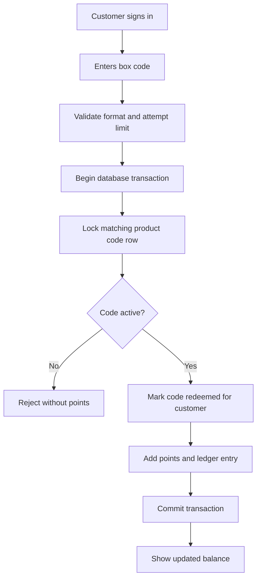
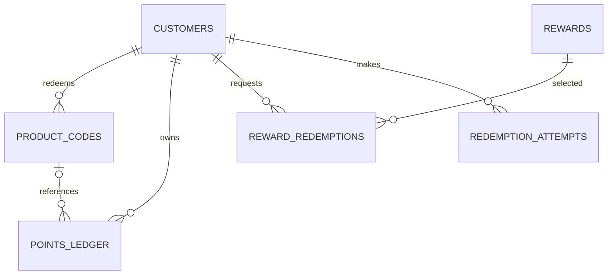

# Architecture

## Stack choice

- **PHP 8 + PDO:** fits the requested XAMPP workflow, is straightforward to host under Apache, and supports parameterized SQL.
- **MySQL/MariaDB + InnoDB:** relational records suit customers, unique box codes, points and reward claims. InnoDB provides transactions and row-level locks for concurrent redemptions.
- **HTML/CSS/vanilla JS:** keeps the student project easy to inspect and explain without a frontend build system.

## Main components

- `config.php`: database connection, session helpers, CSRF, access checks and shared layout.
- `register.php`, `login.php`, `customer/`: customer account, code redemption, points ledger and reward request.
- `admin/`: one-time admin setup, owner dashboard, batch code generation, customer and reward management.
- `sql/schema.sql`: database and table definitions.

## Data model

- `admins`: factory owner login.
- `customers`: customer profile, password hash and cached points balance.
- `product_codes`: unique 12-character code, status, optional redeemer and timestamps.
- `points_ledger`: append-only record of earned/spent points; `reference_code_id` links earned points to the redeemed code.
- `rewards`: reward catalogue and required points.
- `reward_redemptions`: customer's reward request and fulfilment status.
- `redemption_attempts`: records each code submission for rate limiting/audit.

## Redemption flow

## Entity relationships

## Concurrency and fraud controls

The code is unique at the database level. During redemption, the app starts a transaction and selects the matching code `FOR UPDATE`; it then conditionally changes only an active code to redeemed. The points balance and ledger are updated in the same transaction. Concurrent requests for the same code serialize on the row lock; the second request sees a non-active code and receives no points. Per-customer attempt logging and a rolling one-hour limit make simple guessing harder.
